# HealthHub


[](LICENSE)
[](https://github.com/dakshgopani/Health-Hub/commits/main)

**A unified healthcare platform that provides AI-driven diagnostics, secure medical records, and essential health services in one integrated application.**

## Live Demo

[Try HealthHub](https://healthub-web.vercel.app) - Experience the future of healthcare.

## App Screenshots

| Onboarding | Home dashboard |
|:---:|:---:|
|  | 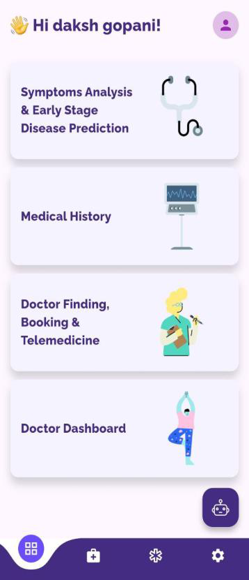 |

| AI disease prediction | Prediction results |
|:---:|:---:|
| 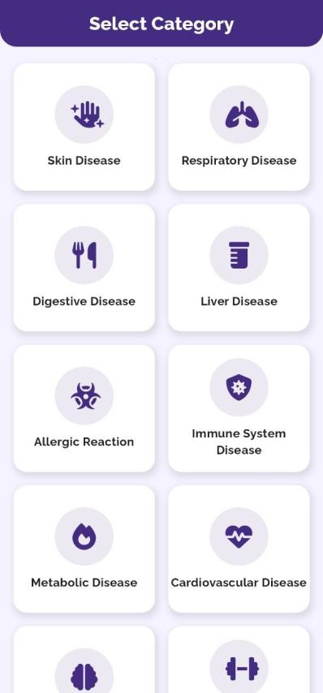 | 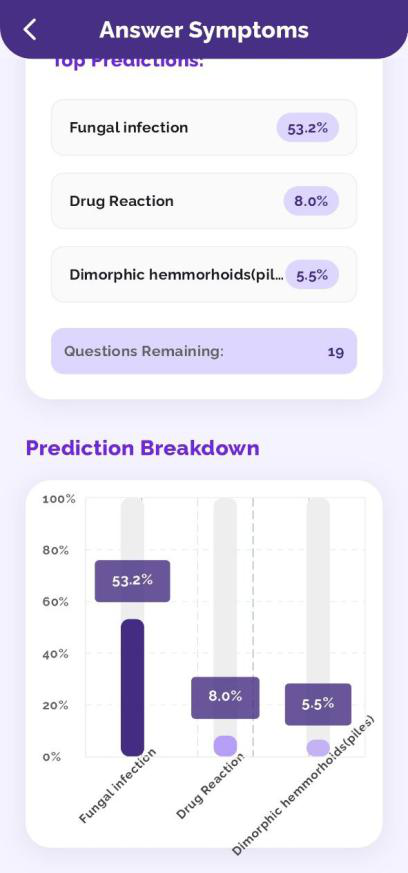 |

| Doctor finder | Medicine recommender |
|:---:|:---:|
|  | 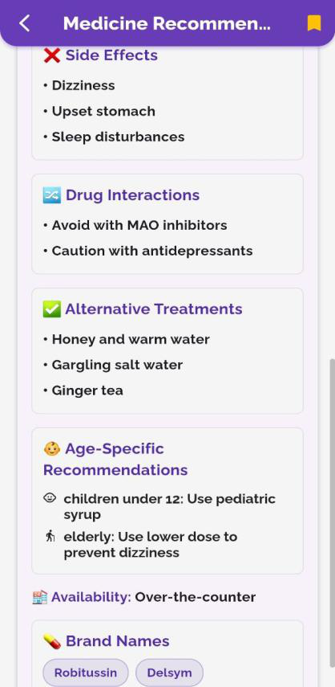 |

| Health chatbot | Emergency services |
|:---:|:---:|
| 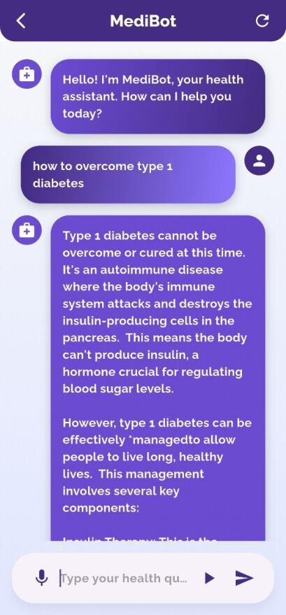 | 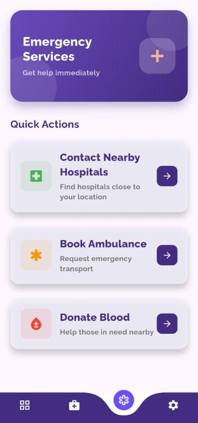 |

### More Features

| Medical history | Medicine scanner |
|:---:|:---:|
| 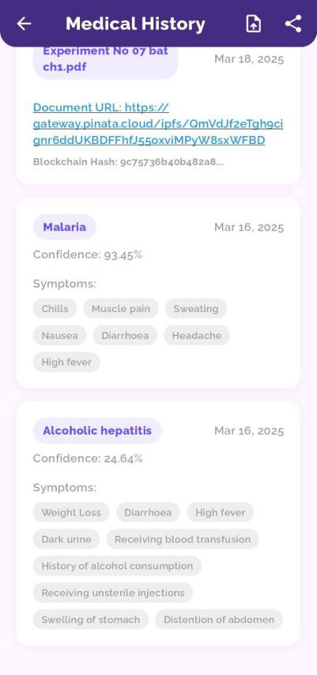 | 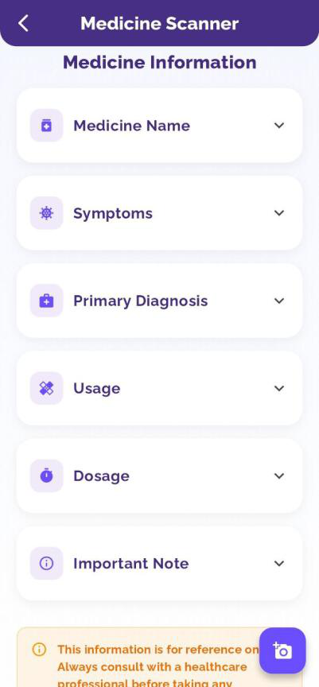 |

| Health quiz | Nearby hospitals |
|:---:|:---:|
| 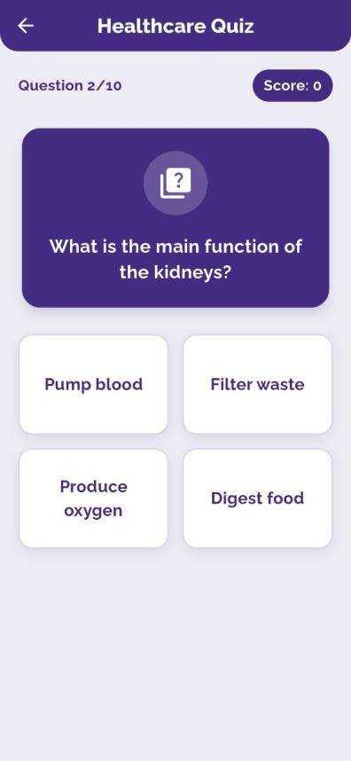 | 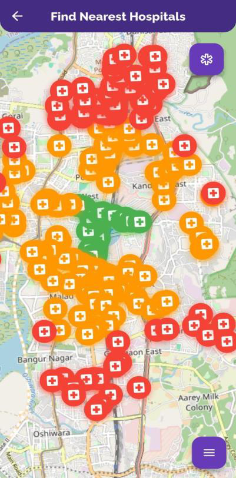 |

| Ambulance booking | Blood donation |
|:---:|:---:|
| 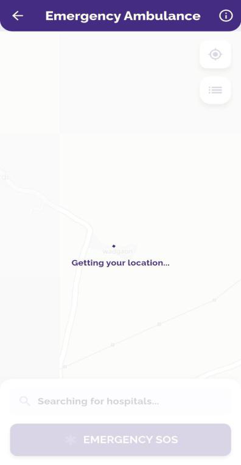 | 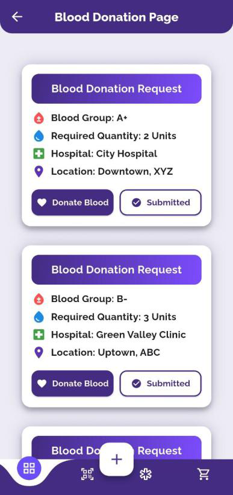 |

## Overview

HealthHub transforms healthcare delivery by combining artificial intelligence, secure data storage, and telemedicine into a single platform. The application addresses critical gaps in healthcare accessibility by providing:

- AI-powered disease prediction through symptom analysis
- Secure, encrypted storage and sharing of medical records
- 24/7 virtual health assistance via conversational AI
- Integrated emergency response services with location-based support

## Key Features

### AI Symptom Checker
Machine learning models (Naive Bayes, SVM, Random Forest) analyze user-reported symptoms to predict potential diseases with confidence scoring. The system guides users through an interactive symptom assessment process.

### Secure Medical Vault
Medical records are encrypted and stored using IPFS with SHA-256 encryption. Users can generate time-limited share codes to grant doctors secure access to specific records.

### Health Chatbot
A conversational AI assistant powered by Google Generative AI that answers health-related questions, provides medical information, and offers guidance. The chatbot maintains conversation history and restricts responses to health topics.

### Medicine Tools
A comprehensive medication assistance suite:
- **Pill Scanner**: Identify medications using device camera
- **Medicine Recommender**: Get AI-powered suggestions for OTC medications
- **Health Quizzes**: Gamified medical knowledge assessments with reward system

### Doctor Finder & Telemedicine
Search and book appointments with verified doctors, schedule video consultations through Agora RTC integration, and manage your healthcare interactions within the app.

### Emergency Services
Integrated emergency response system including:
- Real-time hospital location mapping
- GPS-enabled ambulance booking
- Blood donation and request coordination
- Reward system for donors

## Architecture

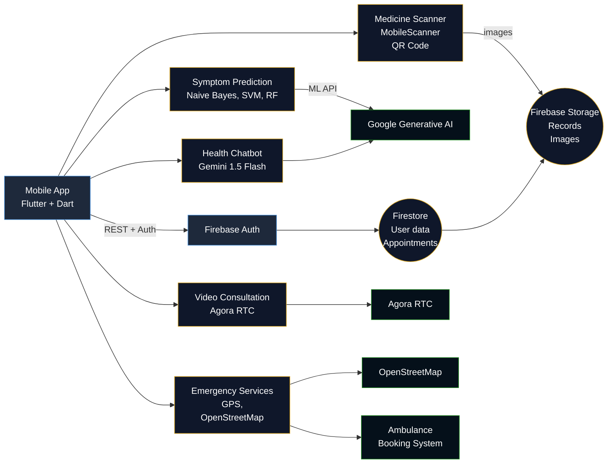

## Technology Stack

| Layer | Technology |
|-------|------------|
| **Mobile Framework** | Flutter (Android, iOS, Web, Windows, macOS, Linux) |
| **Language** | Dart 3.4.1+ |
| **State Management** | Provider pattern |
| **UI Components** | Cupertino Icons, Font Awesome 5, Curved Navigation Bar |
| **Cloud Backend** | Firebase (Auth, Firestore, Storage) |
| **Maps** | OpenStreetMap via flutter_map |
| **AI/ML** | TensorFlow, Google Generative AI |
| **Telemedicine** | Agora RTC Engine |
| **Notifications** | Local & push via workmanager |
| **Media Processing** | Mobile Scanner, QR code packages |
| **Data Storage** | Firestore, IPFS integration |
| **Encryption** | SHA-256, AES |

## Project Structure

```
lib/
├── api/              # API service integrations
├── models/           # Data models (doctors, predictions, symptoms)
├── screens/          # UI screens
│   ├── auth/         # Login, signup, onboarding
│   ├── home/         # Main home screen
│   ├── emergency_services/
│   ├── doctor_appointment_booking/
│   ├── medical_history/
│   ├── medicine/
│   ├── blood_donation/
│   └── chatbot.dart  # Chat interface
├── services/         # Business logic, notifications, payments
├── widgets/          # Reusable UI components
├── theme/            # Colors, text styles
├── firebase_options.dart
└── main.dart

assets/
├── csv/              # Doctor data
├── json/             # Health tips, medicine data, quiz questions
├── images/           # UI assets, screenshots
├── icons/            # App icons
├── fonts/            # Custom fonts
└── logo/             # App logo

test/
└── widget_test.dart
```

## Getting Started

### Prerequisites

- Flutter SDK 3.19.0 or higher
- Dart SDK 3.4.1 or higher
- Firebase project configured
- Android Studio or VS Code with Flutter/Dart extensions

### Installation

```bash
# Clone the repository
git clone https://github.com/dakshgopani/Health-Hub.git
cd Health-Hub

# Install dependencies
flutter pub get

# Configure Firebase
# Update firebase_options.dart with your Firebase configuration
# Or use the provided configuration for the medicalapp-8cca9 project
```

### Running the App

```bash
# Android
flutter run -d android

# iOS
flutter run -d ios

# Web
flutter run -d chrome

# Windows/macOS/Linux
flutter run -d windows  # or macos, linux
```

## Configuration

### Firebase Setup

The application uses Firebase for authentication and data storage. Ensure these Android/iOS configuration files are in place:

- `android/app/google-services.json`
- Firebase iOS configuration in `ios/Runner/`

### Google Generative AI

The chat assistant uses Gemini AI. Set the API key in:

`lib/screens/chatbot.dart` (line 59)

> **Security Note**: In production, use environment variables or secure storage for API keys.

## Testing

```bash
# Run widget tests
flutter test

# Run with coverage
flutter test --coverage
```

## Build & Release

```bash
# Android APK
flutter build apk --release

# Android App Bundle
flutter build appbundle --release

# iOS
flutter build ios --release

# Web
flutter build web
```

## Contributing

Contributions are welcome! Please read [CONTRIBUTING.md](CONTRIBUTING.md) for details on our code of conduct and the process for submitting pull requests.

## License

This project is licensed under the MIT License - see the [LICENSE](LICENSE) file for details.

## Team

- [Daksh Gopani](https://github.com/dakshgopani)
- [Rudra Parmar](https://github.com/rudraparmar76)
- [Vinit Shah](https://github.com/Vinit062006)
